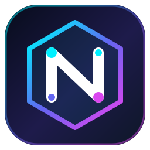
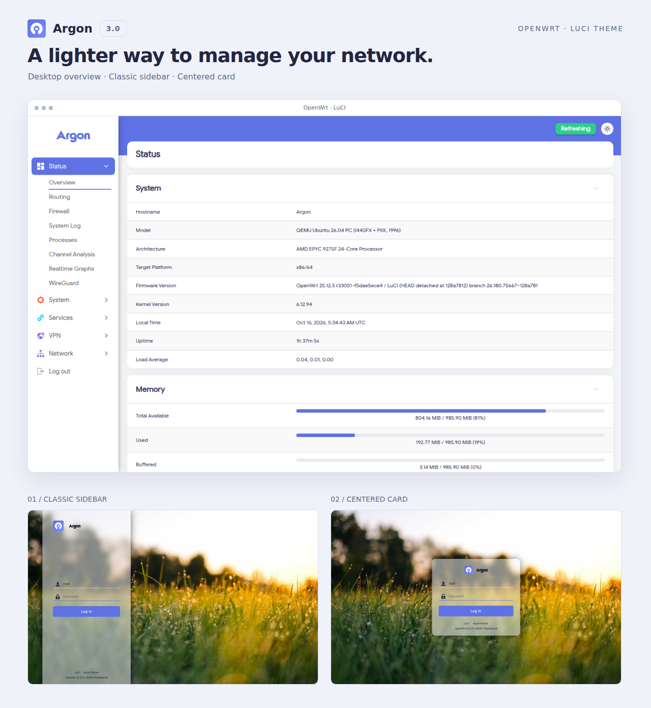
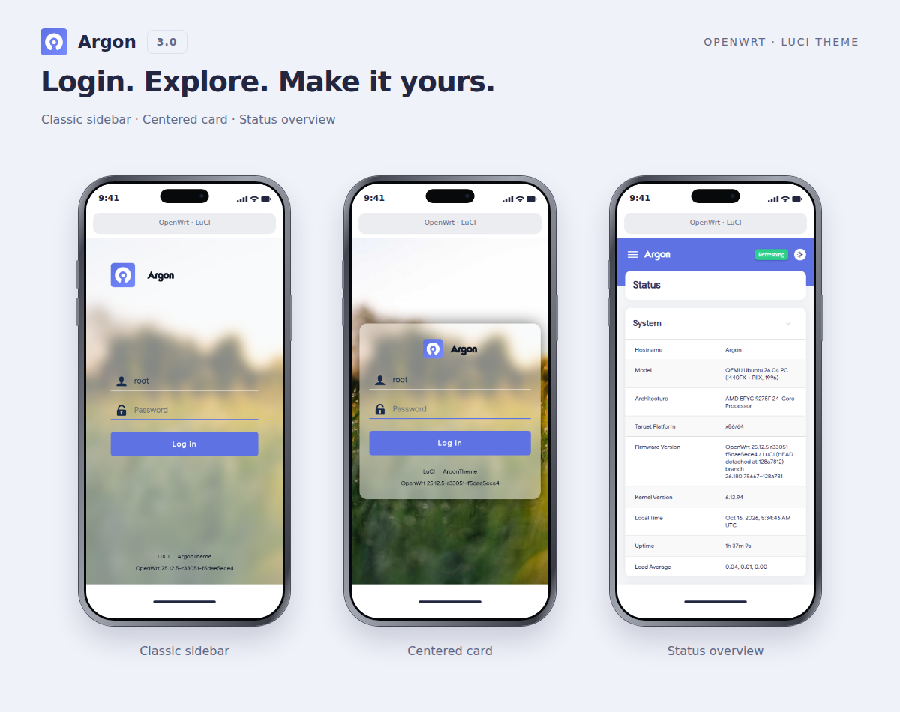
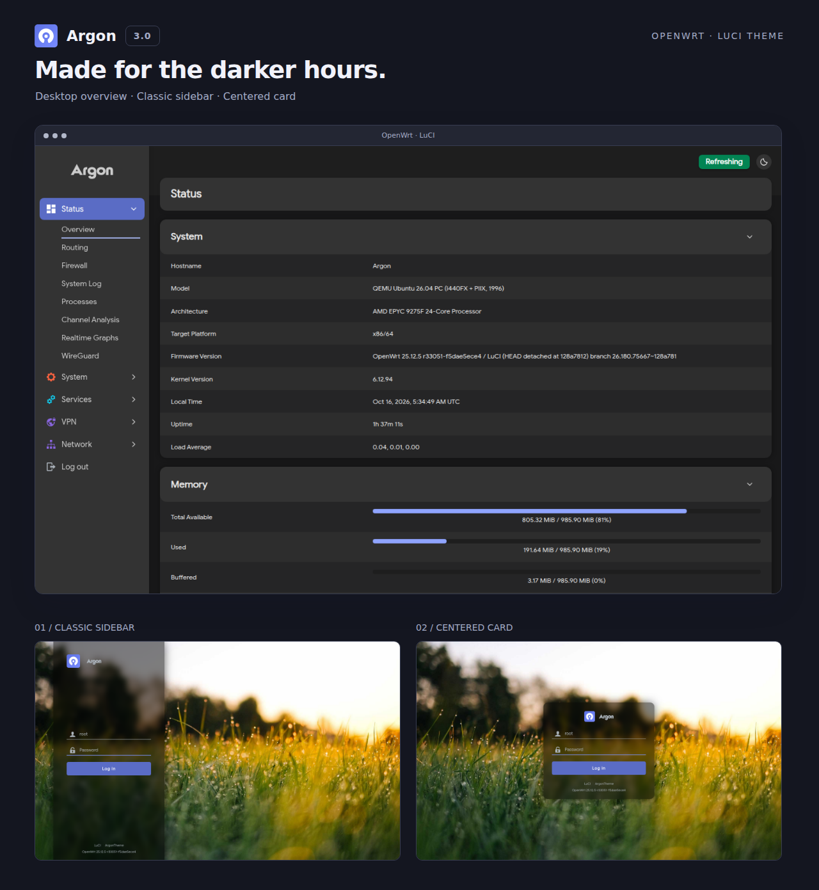
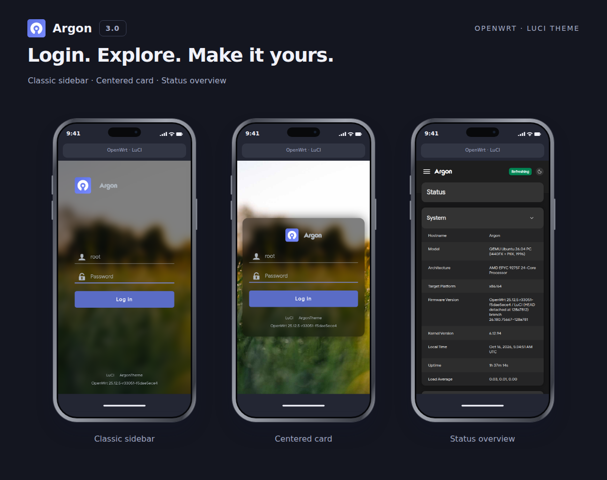

[license]: /LICENSE
[license-badge]: https://img.shields.io/github/license/xlucky0/NuxLab-Theme?style=flat-square&a=1
[prs]: https://github.com/xlucky0/NuxLab-Theme/pulls
[prs-badge]: https://img.shields.io/badge/PRs-welcome-brightgreen.svg?style=flat-square
[issues]: https://github.com/xlucky0/NuxLab-Theme/issues/new
[issues-badge]: https://img.shields.io/badge/Issues-welcome-brightgreen.svg?style=flat-square
[release]: https://github.com/xlucky0/NuxLab-Theme/releases
[release-badge]: https://img.shields.io/github/v/release/xlucky0/NuxLab-Theme?style=flat-square
[download]: https://github.com/xlucky0/NuxLab-Theme/releases
[download-badge]: https://img.shields.io/github/downloads/xlucky0/NuxLab-Theme/total?style=flat-square
<div align="center">


# NuxLab · Modern Frost & Cyberpunk Neon OpenWrt LuCI Theme

**luci-theme-nuxlab** & **luci-app-nuxlab** — A lightweight, modern OpenWrt LuCI theme featuring a frosted-indigo Day Mode and an electric **Cyberpunk Neon** Dark Mode, GPU-composited micro-animations, and customizable login backgrounds.

[![license][license-badge]][license]
[![prs][prs-badge]][prs]
[![issues][issues-badge]][issues]
[![release][release-badge]][release]
[![download][download-badge]][download]

**English** · [简体中文](README_ZH.md)

</div>

## What's new in 3.1

- **Online theme updates.** Check stable releases and install APK v3 packages on compatible firmware, preserving NuxLab settings and verifying package SHA256 and size.
- **Layout fixes.** Improve dashboard actions, overview layouts, dynamic lists and custom IP/MAC inputs across narrow screens, light/dark modes and RTL layouts.
- **Compatibility improvements.** Improve compatibility with stable OpenWrt firmware.

Users on v3.0.0 or earlier must install v3.1.3 manually once to get online updates. Users on v3.1.0 or later can upgrade through Theme updates. See the [release notes](RELEASE.md).

## 3.0 highlights

- **Built-in NuxLab Config.** Manage the theme without a separate plugin.
- **Broad third-party app support.** Refined layouts, forms and tables for most third-party LuCI apps, with desktop/mobile and light/dark adaptations.
- **Two login layouts.** Choose the classic sidebar or centered card.
- **Light and dark.** Switch from the header or follow your system, with customizable accent colors.
- **Your own look.** Adjust login glass effects, set image or video backgrounds, and upload a browser icon and login logo.
- **Desktop and mobile.** Responsive layouts across screen sizes.

## Install

**In 3.0, the theme and configuration features are one package: `luci-theme-nuxlab`. Fresh installations need only this package.** Download the APK v3 package from [Releases](https://github.com/xlucky0/NuxLab-Theme/releases). Releases are for firmware using APK v3 (`apk-tools 3.x`); OPKG/IPK firmware is not supported. Packages and the repository index are signed.

| Package manager | Package | Install |
| --- | --- | --- |
| APK v3 (`apk-tools 3.x`) | `.apk` | `apk add ./luci-theme-nuxlab-*.apk` |

Before installing, compare the SHA256 fingerprint of `nuxlab-apk.pem` with the value in the release notes, then install the public key:

```sh
wget -qO /tmp/install-key.sh https://github.com/xlucky0/NuxLab-Theme/releases/latest/download/install-key.sh && sh /tmp/install-key.sh <SHA256-from-release-notes>
```

The helper verifies the downloaded key fingerprint before placing it in `/etc/apk/keys/`. Then install local packages without `--allow-untrusted`:

```sh
apk add ./luci-theme-nuxlab-*.apk
```

Alternatively, add the signed feed and install from it:

```sh
printf '%s\n' 'https://xlucky0.github.io/NuxLab-Theme/feed' \
  > /etc/apk/repositories.d/customfeeds.list
apk update
apk add luci-theme-nuxlab
```

To install the old-name migration package when upgrading from the standalone `luci-app-nuxlab`, install the matching `luci-app-nuxlab` package first, then the theme in a separate command. APK v2 cannot read these APK packages.

For translations, install the matching `luci-i18n-nuxlab-<language>.apk` package from the same release.

**Key safety:** keep `OPENWRT_PRIV_KEY` private. If it is lost or exposed, rotate the signing key and have users install the replacement public key before updating.

### Release signing setup (maintainers)

Generate a P-256 key pair locally:

```sh
openssl ecparam -name prime256v1 -genkey -noout -out key.pem
openssl ec -in key.pem -pubout -out pub.pem
```

In the repository's **Settings → Secrets and variables → Actions**, add the full PEM contents as the `OPENWRT_PRIV_KEY` and `OPENWRT_PUB_KEY` Actions secrets. Never commit either key. Release CI verifies that they match, signs every APK while packaging with the OpenWrt 25.12.5 SDK, and signs `packages.adb`. CI installs the same noarch packages in official OpenWrt 25.12.5 x86_64 and aarch64 root filesystems. It also checks that installs without a key or with a different key are rejected.

On OpenWrt, after installing the public key, local package upload can be tested at **System → Software → Upload Package**. Select the signed `.apk` and install it without allowing untrusted packages. This LuCI upload interaction is a manual device test; CI uses `apk add` directly.

The APK signing key is not an OPKG/usign key. This repository currently publishes APK v3 only; IPK signing and OpenWrt 24.10 builds are not enabled.

Select **NuxLab** under **System → System → Language and Style → Design**.

<details>
<summary>Already have the old luci-app-nuxlab? Migrate to 3.0</summary>

This applies only when the old standalone configuration plugin is installed. Otherwise, skip this section.

The settings page, colors, backgrounds and branding are all included in the theme. The release's `luci-app-nuxlab` is an **empty migration package using the old package name**. It preserves existing settings and hands its files over to the theme.

1. Install the release public key as described above, then download both `luci-app-nuxlab` and `luci-theme-nuxlab` APK v3 packages from the **same release in the theme repository**.
2. Put both files in one directory on compatible APK v3 firmware and open a terminal there. **Do not uninstall the old plugin first.** Run the second command only after the first succeeds.

```sh
apk add ./luci-app-nuxlab-*.apk
apk add ./luci-theme-nuxlab-*.apk
```

The first command replaces the old plugin with the empty migration package. The second installs the integrated theme and restores your settings. Continue configuring it under **System → NuxLab Config**.

</details>

## Customize

Open **System → NuxLab Config** for login layouts, colors, glass effects, wallpapers and branding. Choose the **Aurora**, **Cyber RGB** or **Mono Glass** visual preset; control animation with `fx_mode=full|saver|off`, RGB with `rgb_mode=0|1`, and hue speed with `rgb_speed=off|slow|normal|fast` (30/14/6-second cycles for slow/normal/fast). For example:

```sh
uci set nuxlab.@global[0].fx_mode='full'
uci set nuxlab.@global[0].rgb_mode='1'
uci set nuxlab.@global[0].rgb_speed='fast'
uci set nuxlab.@global[0].preset='aurora'
uci commit nuxlab
```

Use `fx_mode=saver` for a reduced, slow background effect or `fx_mode=off` to disable FX. Reduced-motion preferences force FX off; low-memory, low-core or slow-frame devices automatically fall back to saver. The header's appearance button switches between **Light mode**, **Dark mode** and **Follow system**; the choice also applies to the login page.

Local image and video backgrounds are supported, along with Bing, Unsplash and Wallhaven wallpapers. Unsplash requires an API access key. Browser icons and login logos accept PNG files, 16–1024 pixels per side, up to 1 MiB; browser icons must be square.

Under **Theme updates**, check the latest stable release, read its release notes and download the package matching your firmware's package manager.

On APK v3 firmware, when a newer version is available, choose **Update now** and confirm to install the theme while preserving your NuxLab configuration. The page shows download, verification and installation status plus installation logs, and resumes monitoring after a page refresh. Reload the page after installation. The updater downloads and verifies the theme and matching APK v3 packages for your existing NuxLab translations before installing them. It also installs the configured LuCI language when that translation is available. Automatic installation requires matching release packages and SHA256 digests and does not downgrade the theme. If verified metadata is missing for an existing translation, update the theme and language packages manually from the same release.

Translations bundled into a firmware's theme package, such as KWRT's Chinese catalog, are preserved during the first upgrade to official packages, including upgrades started by an older updater. A separately installed language package can then take ownership of the catalog.

When building firmware, stop including the old standalone `luci-app-nuxlab` plugin alongside the theme: its files conflict with the integrated settings. See [Build with OpenWrt](docs/DEVELOPMENT.md#build-with-openwrt) for existing build scripts.

## Screenshots

Light and dark views of the overview and both login layouts, on desktop and mobile.









## Development

See the [development guide](docs/DEVELOPMENT.md) for source builds, LESS, templates, icons and checks.

[Releases](https://github.com/xlucky0/NuxLab-Theme/releases) · [Version history](RELEASE.md) · [Report an issue](https://github.com/xlucky0/NuxLab-Theme/issues)

Licensed under [Apache-2.0](LICENSE). Thanks to [luci-theme-material](https://github.com/LuttyYang/luci-theme-material/).
