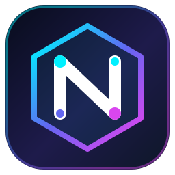
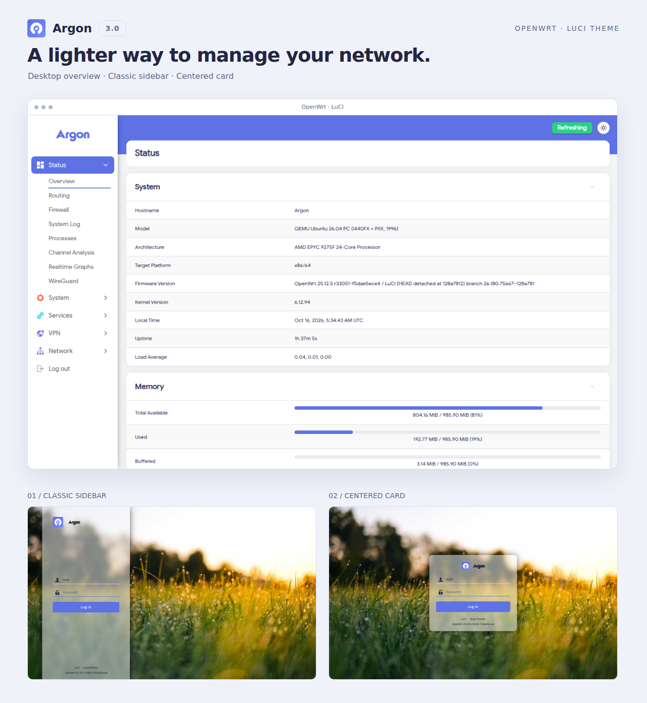
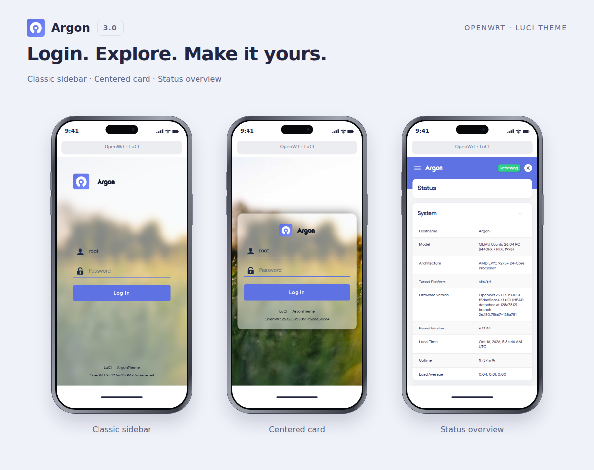
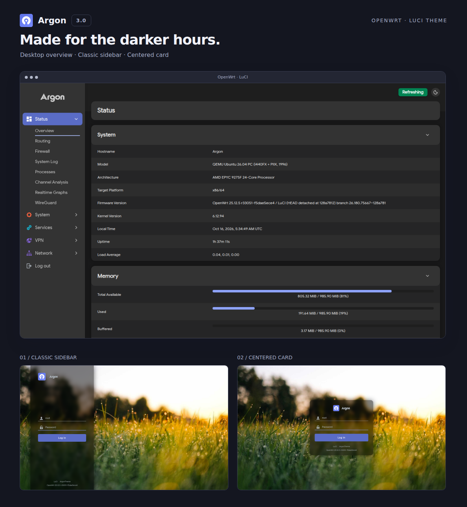
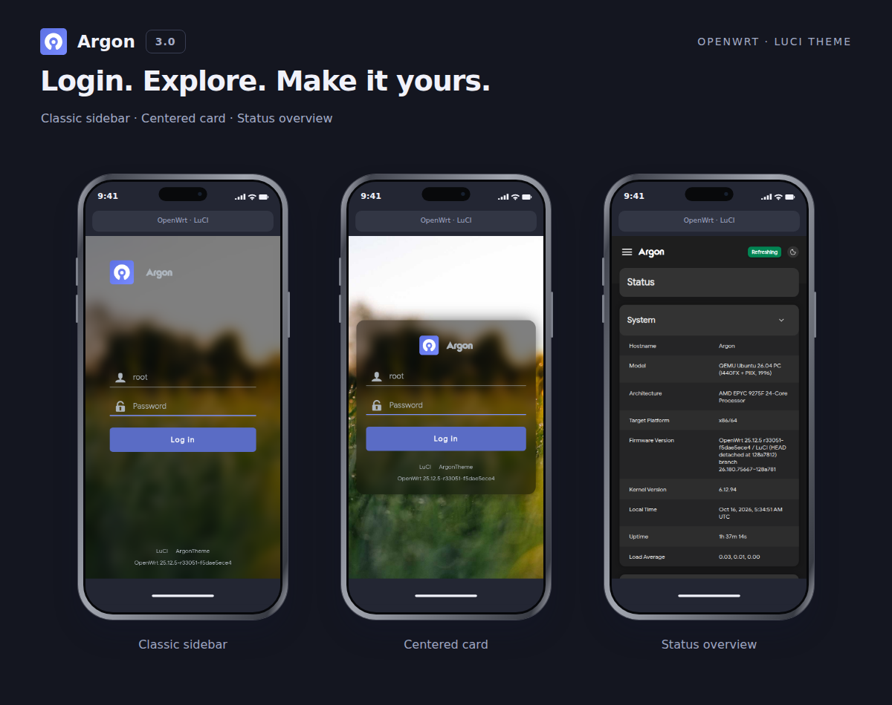

[license]: /LICENSE
[license-badge]: https://img.shields.io/github/license/xlucky0/NuxLab-Theme?style=flat-square&a=1
[prs]: https://github.com/xlucky0/NuxLab-Theme/pulls
[prs-badge]: https://img.shields.io/badge/PRs-welcome-brightgreen.svg?style=flat-square
[issues]: https://github.com/xlucky0/NuxLab-Theme/issues/new
[issues-badge]: https://img.shields.io/badge/Issues-welcome-brightgreen.svg?style=flat-square
[release]: https://github.com/xlucky0/NuxLab-Theme/releases
[release-badge]: https://img.shields.io/github/v/release/xlucky0/NuxLab-Theme?style=flat-square
[download]: https://github.com/xlucky0/NuxLab-Theme/releases
[download-badge]: https://img.shields.io/github/downloads/xlucky0/NuxLab-Theme/total?style=flat-square
<div align="center">


# NuxLab · 现代磨砂靛蓝与赛博霓虹 OpenWrt LuCI 主题

**luci-theme-nuxlab** & **luci-app-nuxlab** — 轻量化现代 OpenWrt LuCI 主题，内置磨砂靛蓝浅色模式与 **Cyberpunk Neon 赛博霓虹**深色模式，配备轻量级 GPU 微动效与自定义登录背景。

[![license][license-badge]][license]
[![prs][prs-badge]][prs]
[![issues][issues-badge]][issues]
[![release][release-badge]][release]
[![download][download-badge]][download]

[English](README.md) · **简体中文**

</div>

## 3.1 新特性

- **在线更新主题**：在兼容固件上检查稳定版并安装 APK v3，保留 NuxLab 设置，校验安装包 SHA256 和大小。
- **布局修复**：优化 Dashboard 操作区、概览布局、动态列表和自定义 IP/MAC 输入框，兼顾窄屏、亮暗色和 RTL 布局。
- **兼容性改进**：改善稳定版 OpenWrt 固件上的兼容性。

v3.0.0 及更早版本用户需先手动安装一次 v3.1.3，之后即可使用在线更新。v3.1.0 及以上用户可直接通过主题更新升级。详见[更新日志](RELEASE_ZH.md)。

## 3.0 主要特性

- **内置 NuxLab Config**：主题设置随主题安装，无需独立插件。
- **广泛适配第三方应用**：针对大多数第三方 LuCI 应用优化布局、表单和表格，兼顾桌面、手机与亮暗模式。
- **两套登录界面**：经典侧栏与居中卡片，自由选择。
- **亮暗配色**：顶部快捷切换或跟随系统，支持自定义主色。
- **个性化外观**：调节毛玻璃效果，设置图片或视频背景，上传网站图标和登录 Logo。
- **桌面与手机适配**：适应不同屏幕尺寸的响应式布局。

## 安装

**3.0 已将主题和配置功能合并到 `luci-theme-nuxlab`，全新安装只需这一个包。** 前往 [Releases](https://github.com/xlucky0/NuxLab-Theme/releases) 下载 APK v3 格式安装包。发行版仅支持使用 APK v3（`apk-tools 3.x`）的固件，不支持 OPKG/IPK 固件。安装包和软件源索引均已签名。

| 包管理器 | 包格式 | 安装命令 |
| --- | --- | --- |
| APK v3（`apk-tools 3.x`） | `.apk` | `apk add ./luci-theme-nuxlab-*.apk` |

安装前请将 `nuxlab-apk.pem` 的 SHA256 指纹与发行说明中的值核对，再安装公钥：

```sh
wget -qO /tmp/install-key.sh https://github.com/xlucky0/NuxLab-Theme/releases/latest/download/install-key.sh && sh /tmp/install-key.sh <发行说明中的SHA256>
```

脚本会校验下载公钥的指纹，通过后才将其放入 `/etc/apk/keys/`。随后可不使用 `--allow-untrusted` 安装本地包：

```sh
apk add ./luci-theme-nuxlab-*.apk
```

也可以添加已签名的软件源并安装：

```sh
printf '%s\n' 'https://xlucky0.github.io/NuxLab-Theme/feed' \
  > /etc/apk/repositories.d/customfeeds.list
apk update
apk add luci-theme-nuxlab
```

从旧版独立 `luci-app-nuxlab` 升级时，先安装同次发行中的 `luci-app-nuxlab` 迁移包，再单独安装主题。APK v2 无法读取本项目的 APK 包。

需要翻译时，安装同次发行的 `luci-i18n-nuxlab-<语言>.apk` 语言包。

**密钥安全：**妥善保管 `OPENWRT_PRIV_KEY`。如果密钥丢失或泄露，必须轮换签名密钥，并让用户先安装新公钥再更新。

### 发行签名设置（维护者）

在本地生成 P-256 密钥对：

```sh
openssl ecparam -name prime256v1 -genkey -noout -out key.pem
openssl ec -in key.pem -pubout -out pub.pem
```

在仓库 **Settings → Secrets and variables → Actions** 中，将完整 PEM 内容分别保存为 `OPENWRT_PRIV_KEY` 和 `OPENWRT_PUB_KEY` Actions Secret。严禁提交密钥。发行 CI 会验证密钥匹配，在 OpenWrt 25.12.5 SDK 打包时签名所有 APK，并签名 `packages.adb`。CI 会在官方 OpenWrt 25.12.5 x86_64 与 aarch64 根文件系统中安装同一组 noarch 包，并确认缺少公钥或使用错误公钥时安装会被拒绝。

在 OpenWrt 安装公钥后，可通过 **系统 → 软件 → 上传软件包** 手动测试 LuCI 上传签名 `.apk`，不要允许不受信任的包。CI 使用 `apk add` 直接测试安装；LuCI 上传交互需要在设备上手动验证。

APK 签名密钥不是 OPKG/usign 密钥。本项目目前仅发布 APK v3，尚未启用 IPK 签名和 OpenWrt 24.10 构建。

在 **系统 → 系统 → 语言和界面 → 主题** 中选择 **NuxLab**。

<details>
<summary>已安装旧版 luci-app-nuxlab？如何迁移到 3.0</summary>

仅适用于已安装旧版独立配置插件的用户；没有安装过该插件可跳过。

3.0 的设置页面、配色、背景和 Logo 管理都在主题包内。发行附件中的 `luci-app-nuxlab` 是**沿用旧包名的空迁移包**，用于保留旧配置并将文件交给主题，不是另一个配置插件。

1. 按照上文安装发行版公钥，再从**主题仓库同一次发行**中下载 APK v3 格式的 `luci-app-nuxlab` 迁移包和 `luci-theme-nuxlab` 主题包。
2. 将两个文件放到兼容 APK v3 的固件同一目录，在该目录打开终端。**无需先卸载旧插件**；第一条成功后，再执行第二条。

```sh
apk add ./luci-app-nuxlab-*.apk
apk add ./luci-theme-nuxlab-*.apk
```

第一步将旧插件升级为空迁移包，第二步安装包含配置功能的新主题，并恢复已有设置。之后继续在 **系统 → NuxLab 主题设置** 中配置即可。

</details>

## 自定义

打开 **系统 → NuxLab 主题设置**，调整登录布局、配色、毛玻璃、壁纸和图标。可选择 **Aurora、Cyber RGB、Mono Glass** 外观预设，并通过 `fx_mode=full|saver|off` 控制动效、通过 `rgb_mode=0|1` 控制 RGB、通过 `rgb_speed=off|slow|normal|fast` 控制色相速度（slow/normal/fast 分别为 30/14/6 秒周期）。例如：

```sh
uci set nuxlab.@global[0].fx_mode='full'
uci set nuxlab.@global[0].rgb_mode='1'
uci set nuxlab.@global[0].rgb_speed='fast'
uci set nuxlab.@global[0].preset='aurora'
uci commit nuxlab
```

将 `fx_mode` 设为 `saver` 可使用更轻、更慢的背景动效，设为 `off` 可关闭效果。系统减少动态效果偏好会自动关闭动效；低内存、低核心数或帧时间过长的设备会自动切换到 saver。页面右上角可切换**亮色模式、暗色模式、跟随系统**，也会应用于登录页。

背景支持本地图片、视频，以及 Bing、Unsplash、Wallhaven 在线壁纸；Unsplash 需填写 API Access Key。网站图标和登录 Logo 支持 PNG，每边 16–1024 像素、最大 1 MiB，网站图标需为正方形。

在**主题更新**中手动检查最新稳定版、查看更新日志，并下载 APK v3 安装包。

在 APK v3 固件上检测到更高版本后，可点击**立即更新**并确认安装主题，同时保留当前 NuxLab 配置。页面显示下载、校验、安装状态及安装日志，刷新页面后可继续查看进度；安装完成后重新加载页面。更新器会先下载并校验主题与现有 NuxLab 翻译对应的 APK v3 语言包，再执行安装；如果发布中提供了 LuCI 当前配置语言的翻译，也会一并安装。自动安装要求对应安装包及 SHA256 校验值，不降级主题。现有翻译缺少可校验的语言包信息时，请从同一次发布中手动安装主题和语言包。

从 KWRT 等将中文翻译内嵌在主题主包的固件升级时，首次安装官方主题会保留原有翻译，使用旧版更新器发起升级也适用。之后安装独立语言包即可完成翻译文件的归属交接。

自行编译固件时，不要再同时引入旧版独立 `luci-app-nuxlab` 插件；它会与主题内置文件冲突。已有自动编译脚本的调整方式见[源码构建说明](docs/DEVELOPMENT_ZH.md#源码构建)。

## 效果展示

亮暗两色，展示桌面与手机端的首页和两套登录界面。









## 开发

源码构建、LESS、模板、图标和检查说明见[开发文档](docs/DEVELOPMENT_ZH.md)。

[下载](https://github.com/xlucky0/NuxLab-Theme/releases) · [版本历史](RELEASE_ZH.md) · [反馈问题](https://github.com/xlucky0/NuxLab-Theme/issues)

采用 [Apache-2.0](LICENSE) 许可证。感谢 [luci-theme-material](https://github.com/LuttyYang/luci-theme-material/)。
